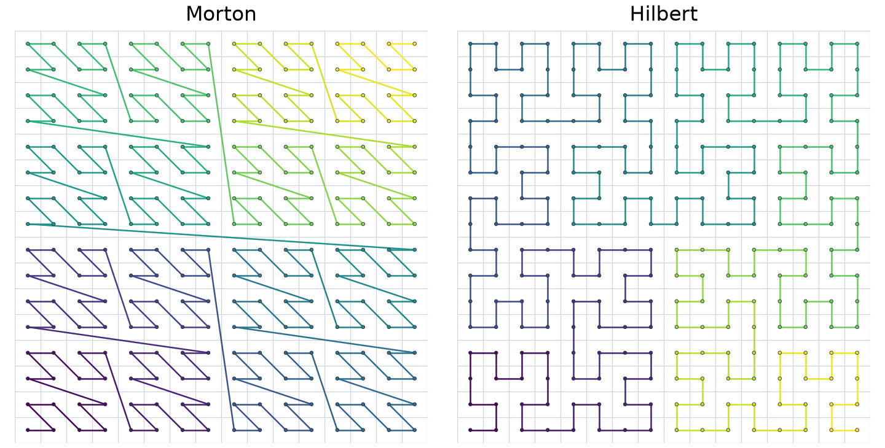
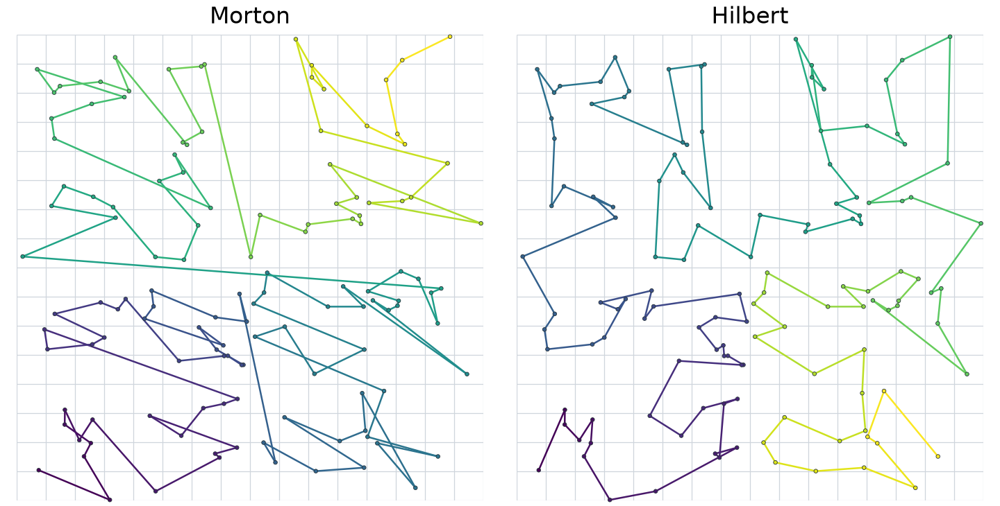

.. ## Copyright (c) Lawrence Livermore National Security, LLC and other
.. ## Axom Project Contributors. See top-level LICENSE and COPYRIGHT
.. ## files for dates and other details.
.. ##
.. ## SPDX-License-Identifier: (BSD-3-Clause)

Spatial ordering with space-filling curves
==========================================

Morton and Hilbert keys give spatial points a one-dimensional order.
Use a ``RectangularLattice`` to map positions to integer cells, then encode
the cells and sort by key. Morton ordering can jump between distant cells;
consecutive Hilbert cells share an edge in 2D or a face in 3D.

   Level-4 curves through all 256 cell centers. Color follows key order.

From positions to keys
----------------------

This example constructs a lattice over the unit square and encodes a point
with both curves:

.. code-block:: cpp

   #include "axom/spin/RectangularLattice.hpp"
   #include "axom/spin/MortonIndex.hpp"
   #include "axom/spin/HilbertIndex.hpp"
   #include <cstdint>

   using Key = std::uint32_t;
   using Point = axom::primal::Point<double, 2>;
   constexpr int level = 4;

   const axom::primal::BoundingBox<double, 2> domain(Point {0., 0.}, Point {1., 1.});
   const auto lattice = axom::spin::rectangular_lattice_from_bounding_box(
     domain, axom::NumericArray<Key, 2>(Key {1} << level));

   const auto cell = lattice.gridCell(Point {0.3, 0.7});
   const auto morton = axom::spin::convertPointToMorton<Key>(cell);
   const auto hilbert = axom::spin::convertPointToHilbert<Key>(cell, level);

   const auto morton_cell = axom::spin::convertMortonToPoint<Key, 2>(morton);
   const auto hilbert_cell = axom::spin::convertHilbertToPoint<Key, 2>(hilbert, level);
   const auto center = lattice.cellBounds(hilbert_cell).getCentroid();

Decoding recovers the integer cell; ``cellBounds()`` gives its spatial extent.
Use the same level when encoding and decoding Hilbert keys. The lattice is
unbounded, so ensure encoded cell coordinates lie in ``[0, 2^level - 1]``.

Compute a key for each point and sort by that key. Points in the same cell
share a key; a stable sort preserves their input order.

Ordering a point set
--------------------

The encoding grid can be finer than the grid used to display the points.
Here, 32-bit keys use level 16 in 2D, while the background grid uses level 4:

   The same 128 points in Morton and Hilbert order. Color follows sort rank.

Straight segments between sparse samples can cross, even in Hilbert order.
The adjacency guarantee applies to the complete sequence of cells.

See :doc:`helper` for depth limits and valid inputs, :doc:`bvh` for selecting
a BVH ordering, and the :download:`complete example
<../../examples/spin_space_filling_curve.cpp>`.
